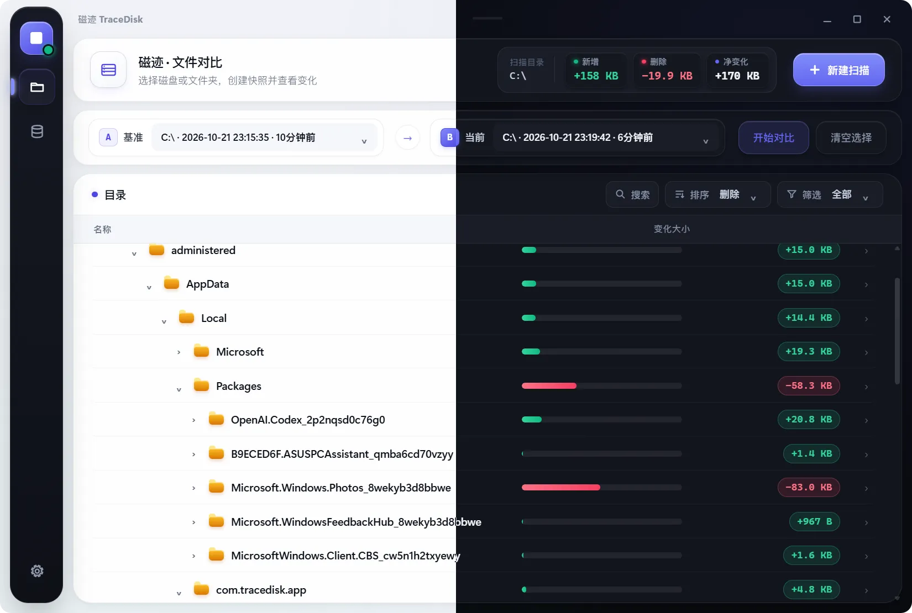

# TraceDisk（磁迹）

<p align="center">
  
</p>

<p align="center">Windows 本地目录快照与文件变化对比工具</p>


## 目录

- [简介](#简介)
- [功能](#功能)
- [安装](#安装)
- [开发](#开发)
- [构建 Windows 安装包](#构建-windows-安装包)
- [数据与隐私](#数据与隐私)
- [许可证](#许可证)

## 简介

TraceDisk 是一个使用 Rust 与 Tauri 2 构建的 Windows 桌面工具，用于扫描目录、保存本地快照，并直观对比两个时间点之间的文件变化。

它适合检查磁盘目录中文件和文档的新增、删除以及大小变化。应用采用简洁的本地界面，扫描数据不会上传到服务器。

<p align="center">
  
</p>

## 功能

- 选择 Windows 磁盘或任意目录生成快照。
- 对比两个快照，查看新增、删除和文件大小变化。
- 以目录树查看变化，并展开到具体文件和文档。
- 在目录或文件上右键，展开目录、复制路径或在资源管理器中定位。
- 搜索、排序和筛选对比结果。
- 快照重命名、删除，并使用文件夹进行分类管理。
- 快照管理支持按时间和盘符筛选。
- 自定义快照保存位置，并可恢复默认位置。
- 支持中文与英文界面、浅色/深色/跟随系统主题。
- 扫描过程中显示进度提示，并记录本地日志。

## 安装

### 使用已构建的 Windows 安装包

构建完成后，NSIS 安装包位于：

```text
src-tauri/target/release/bundle/nsis/
```

运行其中的 `.exe` 文件即可安装。当前安装模式为当前用户安装，不需要管理员权限。

### 从源码安装开发依赖

需要以下环境：

- Windows 10/11 x64
- Rust stable（项目最低版本为 1.90）
- Node.js 与 npm
- Visual Studio C++ Build Tools（MSVC）及 Windows SDK
- WebView2 Runtime

在项目根目录执行：

```powershell
npm install
```

## 开发

启动开发模式：

```powershell
npm run dev
```

前端界面文件位于项目根目录的 `index.html`，Rust/Tauri 后端位于 `src-tauri/`。

## 构建 Windows 安装包

```powershell
npm run build
```

该命令会先构建界面，再调用 Tauri 生成 Windows NSIS 安装程序。生成文件位于：

```text
src-tauri/target/release/bundle/nsis/
```

Rust 可执行文件位于：

```text
src-tauri/target/release/
```

## 数据与隐私

- 扫描内容和快照默认只保存在本机。
- 快照使用 `.tdsnap` 文件保存，内部为压缩后的 JSON 记录。
- 更改快照保存位置不会移动或删除原位置中已有的快照。
- 删除快照会直接删除对应的本地文件，请在删除前确认不再需要。


## 许可证

本项目采用 [GNU General Public License v3.0](https://www.gnu.org/licenses/gpl-3.0.html) 授权。
